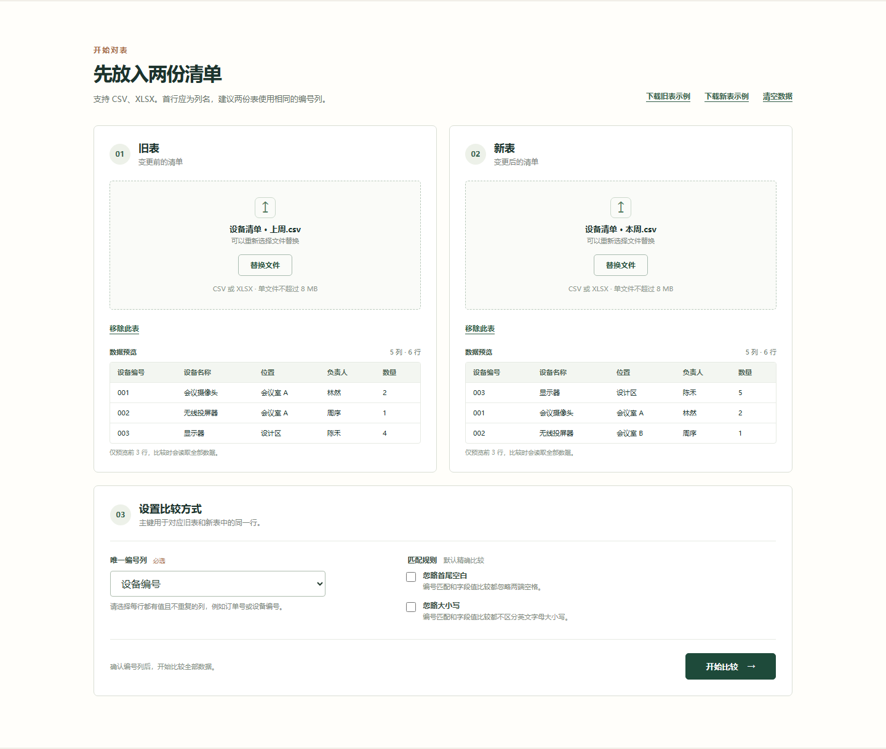
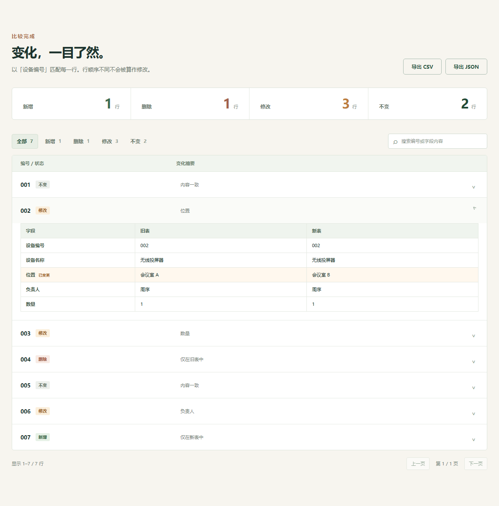

# 对表

对表是一个在浏览器中运行的表格差异检查工具。它按用户选择的一列编号对齐两份 CSV 或基础 XLSX 表格，展示新增、删除、修改和未变化的记录，并列出每个修改字段的前后值。

[English](docs/README.en.md) · [详细使用指南](docs/USER-GUIDE.zh-CN.md) · [在线入口](https://tolkmislk.github.io/duibiao/) · [源代码](https://github.com/TolkmisLK/duibiao)

## 能做什么

- 读取 UTF-8、逗号分隔的 CSV 和基础 XLSX 文件，并为 XLSX 选择工作表。
- 选择一列作为对齐主键，不依赖两份表格的行顺序。
- 汇总新增、删除、修改和未变化记录。
- 展示修改字段的原值和新值，并诊断空编号与重复编号。
- 默认精确比较，也可忽略字段首尾空白或英文字母大小写。
- 将结果导出为 CSV 或 JSON，便于复核和归档。
- 全程在当前浏览器页面内解析；文件内容不会由应用上传到服务器。

## 三步开始

1. 选择“旧表”和“新表”文件；CSV 应为 UTF-8 编码并使用逗号分隔。XLSX 会在前 32 张工作表中跳过空表或表头无效的表，默认读取首张有效表并提示跳过原因。
2. 选择两份表共有且含义一致的编号列，例如“设备编号”，然后按需设置比较选项。
3. 开始对比，检查编号诊断和差异明细，再下载 CSV 或 JSON 报告。

可以从工作表下拉框明确改选其他表。若选中的表无效，错误提示后仍可选回有效表；超出大小、行列或单元格限制的工作表，以及损坏的 XLSX，会直接报错，不会被自动跳过。

### 示例

假设旧表包含编号 `001`、`002`，新表包含 `001`、`003`：

- `001` 的“位置”从“会议室 A”变为“会议室 B”：修改；
- `002` 只在旧表中：删除；
- `003` 只在新表中：新增。

编号按文本精确匹配，因此 `001` 和 `1` 默认是两个不同编号。更多空编号、重复编号和选列建议见[使用指南](docs/USER-GUIDE.zh-CN.md)。

## 界面预览





## 本地开发

需要 Node.js 22.12 或更高版本。

```bash
npm ci
npm run dev
```

常用检查命令：

```bash
npm run test
npm run check
npm run build
npx playwright install chromium
npm run test:e2e
```

## 技术栈

- React 19、TypeScript 5、Vite 8
- Papa Parse（CSV）
- SheetJS（XLSX）
- Vitest 与 Playwright
- Web Worker（文件解析）

## 隐私、安全与限制

- 应用在本地页面中读取文件，不会主动上传文件内容；关闭或刷新页面后，当前页面中的数据会被清除。下载的报告仍保留在用户选择的本地位置。
- 原文件只读，应用不会覆盖它们。导出 CSV 时，会为可能被电子表格软件当作公式执行的文本添加安全前缀。
- 单个文件上限为 8 MB；每个所选工作表最多 20,000 个数据行、100 列和 500,000 个单元格。浏览器内存和设备性能仍可能形成更低的实际上限。
- XLSX 公式只读取文件中已有的缓存结果，不执行或重新计算公式。复杂格式、图表、宏、批注、合并单元格语义等不保证保真。
- 当前功能面向值级对比，不验证版式、颜色、公式逻辑或文件签名。请在导出前检查编号诊断和差异内容。

安全问题请按[安全政策](SECURITY.md)报告。

## 贡献与许可

提交问题或代码前请阅读[贡献指南](CONTRIBUTING.md)。项目使用 [MIT License](LICENSE)。
